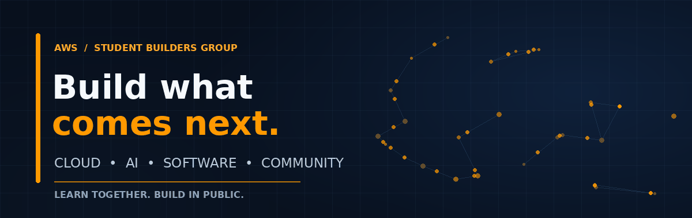

<!--
AWS SBG VIT — Organization Profile README
Place this file at: .github/profile/README.md
Place the assets folder beside this README.
-->

<div align="center">



<br/>

### A community for curious minds and hands-on builders.

**Learn together. Build in public. Create what comes next.**

[Explore our repositories](https://github.com/AWS-SBG-VIT?tab=repositories) ·
[Browse open issues](https://github.com/AWS-SBG-VIT?tab=issues) ·
[Contribute](https://github.com/AWS-SBG-VIT)

<br/>


</div>

---

## `01` — The idea

Technology moves fast. The best way to keep up is to **learn by doing**.

AWS Student Builders Group at VIT is a space for students to explore ideas, experiment with modern tools, collaborate with other builders, and turn concepts into working projects.

Whether you're taking your first steps in cloud computing or shipping a more ambitious application, the goal stays the same: **stay curious, build consistently, and share what you learn.**

## `02` — What we're exploring

<table>
<tr>
<td width="50%" valign="top">

### ☁️ Cloud & AWS
Understand cloud fundamentals and build with scalable, reliable infrastructure.

</td>
<td width="50%" valign="top">

### ✨ AI & Machine Learning
Experiment with intelligent applications, automation, and emerging AI workflows.

</td>
</tr>
<tr>
<td width="50%" valign="top">

### 🛠️ Software Engineering
Design, develop, test, and ship applications that solve real problems.

</td>
<td width="50%" valign="top">

### 🤝 Community & Collaboration
Learn from peers, share knowledge, contribute to projects, and grow together.

</td>
</tr>
</table>

> These are areas of interest, not a claim that every topic or activity is currently running. Explore the repositories for active work.

## `03` — Explore the work

<div align="center">

| **Start here** | **What you'll find** |
|:--|:--|
| [Repositories →](https://github.com/AWS-SBG-VIT?tab=repositories) | Projects, experiments, and shared code |
| [Issues →](https://github.com/AWS-SBG-VIT?tab=issues) | Open tasks and opportunities to contribute |
| [Pull requests →](https://github.com/AWS-SBG-VIT/pulls) | Changes and collaboration in progress |

</div>

**Have a project you want people to notice?** Pin the most useful repositories on the organization profile and add a short description, setup instructions, screenshots, and a clear contribution guide to each project.

## `04` — Make your first contribution

You don't need to know everything before you start. Pick a small task, ask a good question, and build from there.

1. **Explore** the repositories and find a project that interests you.
2. **Read** its README, setup steps, and contribution guidelines.
3. **Look for an issue** or suggest a focused improvement.
4. **Create a branch**, make your change, and test it.
5. **Open a pull request** explaining what you changed and why.

```bash
# 1. Fork the repository you want to contribute to.
# 2. Clone your fork:
git clone <your-fork-url>
cd <repository-name>

# 3. Create a focused branch:
git switch -c feat/your-contribution

# Make your changes, test them, then commit:
git add .
git commit -m "Describe your contribution"
git push -u origin feat/your-contribution

# 4. Open a pull request on GitHub.
```

Before contributing, follow the contribution instructions and code of conduct in the individual repository, if provided.

## `05` — Our builder mindset

<div align="center">

**CURIOSITY** &nbsp; · &nbsp; **EXPERIMENTATION** &nbsp; · &nbsp; **COLLABORATION** &nbsp; · &nbsp; **CONSISTENCY**

*Small experiments become stronger skills. Shared work becomes a stronger community.*

</div>

## `06` — Stay connected

The best place to begin is right here: explore the code, learn from existing work, and contribute something useful.

- **Code:** [AWS-SBG-VIT repositories](https://github.com/AWS-SBG-VIT?tab=repositories)
- **Discussions through issues:** [Open issues](https://github.com/AWS-SBG-VIT?tab=issues)
- **Organization:** [github.com/AWS-SBG-VIT](https://github.com/AWS-SBG-VIT)

If the group has official social pages, a community chat, or an event calendar, add verified links here so visitors can find the right channel.

---

<div align="center">

**Made for builders. Open to ideas.**

<sub>AWS Student Builders Group · VIT</sub>

</div>
